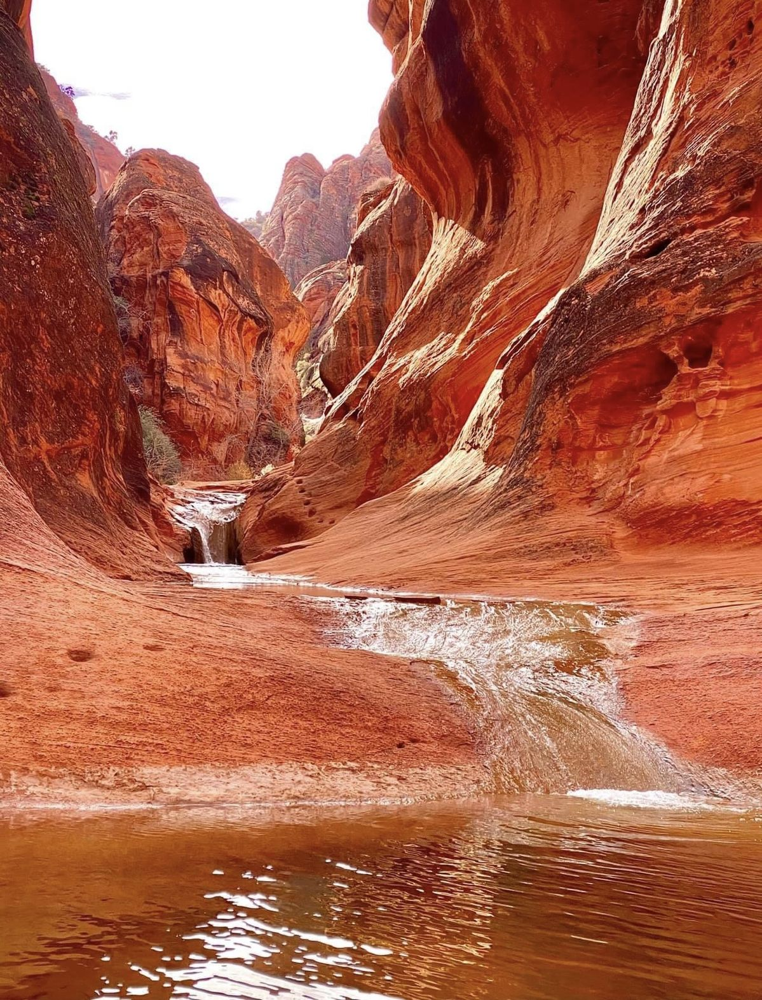
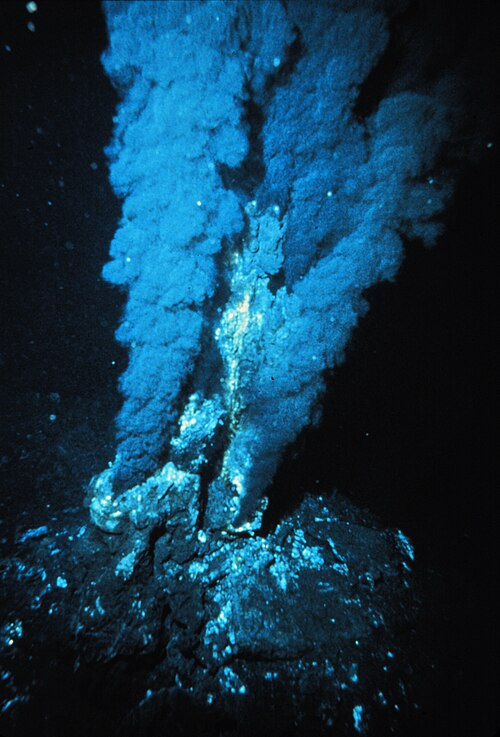
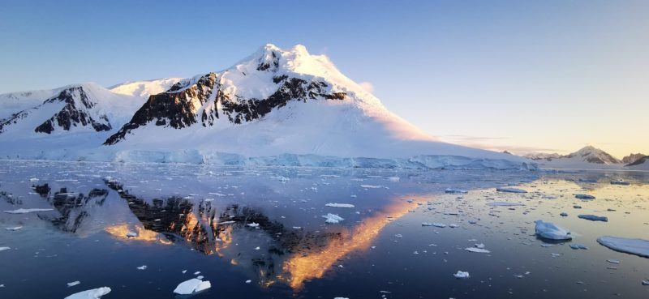

# M1 世界

> 截止：10/1（四）上課前 15:30
> 這一站在做什麼、怎麼做、卡住看哪裡，都在課程頁：<https://course.interaction.tw/oop/#milestones>

> 這一站是**報告站**：每個人上台三分鐘，簡報一律轉成 PDF 放這個資料夾。
> **9/24 上課帶著手上的材料來跟老師討論**：三個世界候選、查到的資料與來源、做到一半的簡報都可以，這是這一站唯一一定要到的關卡。材料不強制上傳，建議先丟進這個資料夾的 `notes.md`，10/1 寫報告時直接用得上。

把「沒有人類之後」從想像變成有根據的世界。

## 這一站要交的四件套

- [x] 程式碼或文件：世界觀研究報告（至少五個點得開的來源連結）
- [x] 截圖或影片：世界的參考圖、示意圖都可以
- [x] 反思：下面那段，一百到兩百字，自己寫
- [x] AI 揭露欄：下面的表格
- [x] 簡報 PDF：檔名 `m1-簡報.pdf`，放這個資料夾裡

### 世界環境參考圖

| 黃石國家公園 | 北大西洋深海熱泉 | 南極洲冰蓋 |
| :---: | :---: | :---: |
|  |  |  |

## 世界觀研究報告：人類消失五萬年後的極端生態系

### 一、 世界觀核心設定
* **時代背景**：人類文明消失約五萬年後的地球。人類遺留的工業與氣候干擾已被自然徹底消化或重塑，地球重回無人為介入的極端演化進程。
* **創作靈感**：延伸自史特魯伽茨基兄弟科幻小說《路邊野餐》（Roadside Picnic）中「造訪帶」的未知環境概念——將「人類無法理解的環境威脅與物理梯度」轉化為五萬年後極端生態系的基本規則，生物必須在未知的生存壓力中演化出特化感官與生理機制。

### 二、 三大極端生態系與推導
1. **黃石國家公園（地熱、強酸鹼、嗜熱菌網絡）**
   * **環境特徵**：活躍的地下岩漿庫造就了溫泉、間歇泉、泥火山與噴氣孔。水體富含硫化物、礦物質並呈現極端酸鹼度，低溫嚴冬與滾燙地熱形成強烈對比。
   * **演化推論**：生物演化出高耐熱的矽質外甲與耐酸表皮，依賴地熱化學梯度生存，發展出對熱輻射極度靈敏的感測器官。
2. **北大西洋深海熱泉（無光、深海超高壓、黑煙囪化能合成）**
   * **環境特徵**：數千公尺無光深海，水溫高達 300°C 以上的熱泉噴口因水壓無法沸騰。無光合作用，生態系基礎完全由硫化氫「化能合成（Chemosynthesis）」微生物驅動。
   * **演化推論**：生物具備抗高壓的堅硬節肢結構，視覺退化，取而代之的是能偵測微弱震動與化學濃度的觸鬚，與化能細菌形成緊密共生。
3. **南極洲冰下水系（極端低溫、高壓隔離、冰下暗湖）**
   * **環境特徵**：數公里厚實冰蓋下方存在封閉數萬年甚至數百萬年的液態水域（如沃斯托克湖），處於極低溫、高水壓、完全黑暗與高溶氧的孤立狀態。
   * **演化推論**：生物演化出極低代謝率與天然抗凍機制，對微弱地熱洋流與冰層壓力的微小變化具備極高感應力。

### 三、 參考資料與文獻來源（5 個點得開的來源）
1. [《路邊野餐》（Roadside Picnic）文學概念 — Wikipedia](https://en.wikipedia.org/wiki/Roadside_Picnic)
   * 參考依據：不可知危險、異常物理區域與非人類邏輯生態環境的文學原型。
2. [黃石國家公園地熱特徵與嗜熱微生物 — U.S. National Park Service (NPS)](https://www.nps.gov/yell/learn/nature/hydrothermal-features.htm)
   * 參考依據：地熱噴泉成因、礦物沉積梯級與極端環境嗜熱菌生態結構。
3. [NOAA 海洋探索：深海熱泉與化能合成生態 — NOAA Ocean Exploration](https://oceanexplorer.noaa.gov/facts/vents.html)
   * 參考依據：深海黑煙囪形成、無光深海食物鏈與硫化氫化能合成生物機制。
4. [NASA 地球觀測站：南極沃斯托克冰下湖探勘 — NASA Earth Observatory](https://earthobservatory.nasa.gov/images/7323/lake-vostok)
   * 參考依據：南極數千公尺冰蓋下方封閉湖泊的遙測發現與極端孤立生態。
5. [《沒有我們的世界》（The World Without Us by Alan Weisman）— Wikipedia](https://en.wikipedia.org/wiki/The_World_Without_Us)
   * 參考依據：人類消失後地球地貌、人造物崩解與自然重掌生機的長期推論。

## 反思

我先設定成在人類消失五萬年後的地球，選了黃石、北大西洋深海熱泉、南極洲此類極端環境，並從《路邊野餐》這本小說延伸，過程中我發現自己設計環境時，容易被固有印象限制住而變得死板，下一站更具體設計生物，需要想怎麼生存、感知危險，讓生物像是活生生從這個環境演化出來。

## AI 揭露欄

| 項目 | 內容 |
|------|------|
| 工具 | agy／Claude／ChatGPT |
| 日期 | 2026／9／30 ~ 10／1 |
| prompt 摘要 | 1. 探討人類消失五萬年後的極端生態系與世界觀設定（參考《路邊野餐》未知環境概念）。 2. 針對黃石公園、北大西洋深海熱泉、南極洲三個候選生態系進行環境特徵與生物適應推導。 3. 協助簡報檔案整理、路徑排查與 Git 版本同步。 |
| 採用範圍 | **由 AI 協助發想與整理：** 1. 輔助發想三大極端環境（地熱/高壓/冰蓋）的特徵與生存策略推導。 2. 協助本機 Git pull 同步與檔案交付排查。  **由我主導核心概念與驗收：** 1. 選定《路邊野餐》「無法完全理解的環境危險」為核心世界觀。 2. 決定黃石、深海熱泉與南極洲三大候選世界與生物設計方向。 3. 製作簡報內容並親自上傳 `m1-簡報.pdf`。 |

## 課前準備與物種日誌

過程中的筆記、查到的資料、想到一半的點子，寫在這個資料夾的 `notes.md`（需要時自己建，格式自由）。
