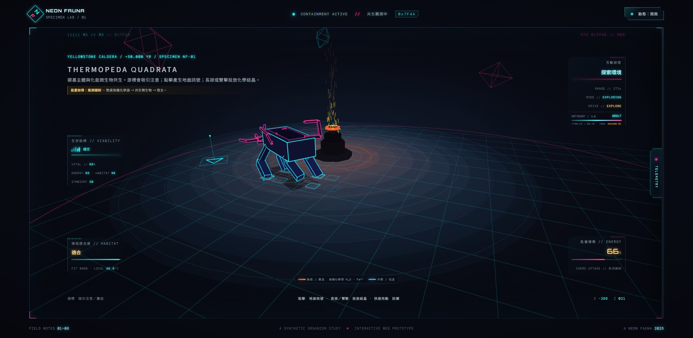

# M3 個體

> 截止：11/12（四）上課前 15:30
> 這一站在做什麼、怎麼做、卡住看哪裡，都在課程頁：<https://course.interaction.tw/oop/#milestones>

> 這一站是**報告站**：每個人上台三分鐘，簡報一律轉成 PDF 放這個資料夾。

讓牠有天性：會對環境反應，看得出是活的。

## 這一站要交的四件套

- [x] 程式碼：有行為的個體（`index.html`、`sketch.js`、`ecology.js`、`audio.js`、`style.css`、`vendor/`、`fonts/`）
- [x] 截圖或影片：牠對環境反應的樣子（`m3-creature.jpg`）
- [x] 反思：下面那段，一百到兩百字，自己寫
- [x] AI 揭露欄：下面的表格
- [x] 簡報 PDF：檔名 `m3-簡報.pdf`，放這個資料夾裡（物種發表會）

### 物種動態與環境反應展示

<video src="m3-creature.mp4" controls width="100%"></video>

> 🎬 **展示影片**：[點此在 GitHub 開啟／預覽 30 秒重點操作動態影片 (`m3-creature.mp4`)](m3-creature.mp4)  
> 📑 **簡報預覽**：[點此在 GitHub 直接開啟／預覽物種發表會簡報 (`m3-簡報.pdf`)](m3-簡報.pdf)  
> 📖 **完整設定與操作指南**：請參閱本資料夾的 [`notes.md`](notes.md) 物種日誌。

---

## 物種核心設定與本站升級摘要

* **物種學名／名稱**：**THERMOPEDA QUADRATA**（方形熱足體 / 破火山口共生體）
* **世界舞台**：人類文明消失五萬年後的黃石破火山口（Yellowstone Caldera）
* **推測機制**：碳基宿主 ✕ 化能合成微生物。熱泉釋放 $H_2S$、$Fe^{2+}$ 等無機化學源，共生菌轉化為宿主可用能量（作品推測假說，介面嚴謹標註為推測機制）。
* **四大真實生存指標**：
  * `ENERGY`（能量儲備）：靠近熱泉化學源或覓食時上升；移動代謝消耗。
  * `HABITAT`（環境適合度）：由局部溫度、pH 與個體耐受範圍決定。
  * `SYMBIONT`（共生整合度）：靠近化學源或吸食菌毯時上升。
  * `VITAL`：由能量 45% + 環境適合度 35% + 共生度 20% 構成的綜合生存指標。
* **環境驅動自主行為**：
  * **探索 EXPLORE**：狀態良好時自主漫遊。
  * **群聚 CLUSTERING**：能量過低時自主趨向熱泉或結晶。
  * **遷移 MIGRATING**：環境溫差超標時，沿熱梯度主動遷徙取暖或散熱。
  * **天性互動**：長按地面種植化能結晶貼合吸食、快速晃動威脅觸發防禦硬殼、靜止 10 秒節能休眠、間歇泉超載噴發避險逃竄。
* **發育生長與選擇考驗**：
  * 載入即播放 28 秒動態生長展示（繁殖體 ➔ 幼體 ➔ 成體），部位等比長成。
  * Seed 遺傳演算：每隻個體具備專屬體型比例與環境耐受區間。
  * 形態分支選擇：可選擇「長足 LONG LEGS」、「寬甲 BROAD HULL」或「密觸角 DENSE ANTENNA」，並執行 20 秒極限「熱梯度考驗（Thermal Trial）」，結果寫入個體檔案。

---

## 反思

在M3這個階段，我不只讓生物能對溫度和酸鹼值做出反應，還做了一段發育生長動畫，以及三種形態分支的選擇實驗。過程中最大的難處，是生物在等比例縮放的時候，關節和觸角的連接位置常常會錯開，動作也就跟著不連貫。後來靠著動態錨點的運算，這個問題慢慢改善了，生長的過程也變得平滑許多。

另外，這次我也試著調度好幾個AI來分工做不同的模組，從中學到了怎麼把問題拆開，再把各個模組整合起來。到了這一階段，原本只有幾何外型和移動能力的生物，已經能對環境的壓力有所反應，也有了初步的生長過程和形態差異。

下一步的M4，我想進一步研究群體生態，看看長足型、寬甲型這些不同的分支，在同一個棲地裡會怎麼競爭、怎麼適應，最後又會出現什麼樣的生存淘汰結果。

---

## AI 揭露欄

| 項目 | 內容 |
|------|------|
| 工具 | agy／Claude Code／ChatGPT／DeepSeek |
| 日期 | 2026／10／29～2026／11／12 |
| prompt 摘要 | 將單一幾何生物動畫，升級為以演算法生長、參數化演化、環境壓力與觀眾互動為核心的自主人工生態系，同時保留原有的黃石五萬年後世界觀與抽象幾何物種設計。 |
| 採用範圍 | **AI 協作部分：** 1. **Claude Code / ChatGPT / DeepSeek**：輔助編寫 `ecology.js` 生態指標公式、生長等比變形演算法與 Web Audio API 原生音效合成器 `audio.js`。 2. **Chrome CDP 自動化**：協助以無頭瀏覽器精準捕捉 10 張生物狀態截圖。 3. **agy**：協助專案檔案防護、本機程式碼同步檢驗與 Git / GitHub 交付推送。  **由我主導規劃與驗收：** 1. 確立黃石破火山口世界觀與「推測共生機制」的核心定位，堅持保留幾何美學。 2. 規劃四大生存指標權重、三大環境驅動行為邏輯，以及長按種植晶體覓食、晃動防禦等天性互動走向。 3. 制定長足、寬甲、密觸角三種形態分支實驗與熱梯度考驗條件。 4. 親自設計、製作並匯出 `m3-簡報.pdf`，完成期中物種發表會簡報。 |

---

## 課前準備與物種日誌

過程中的筆記、查到的資料、想到一半的點子，寫在這個資料夾的 [`notes.md`](notes.md)（已建立，包含完整生態推測設定、操作指南與遙測指令）。
